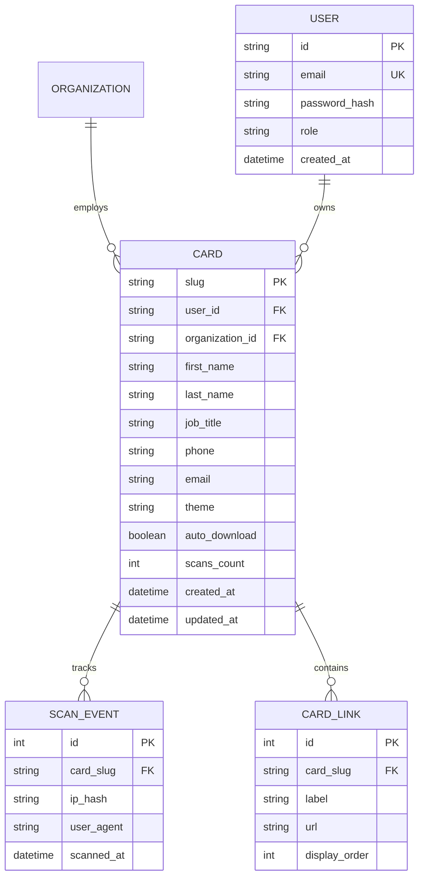
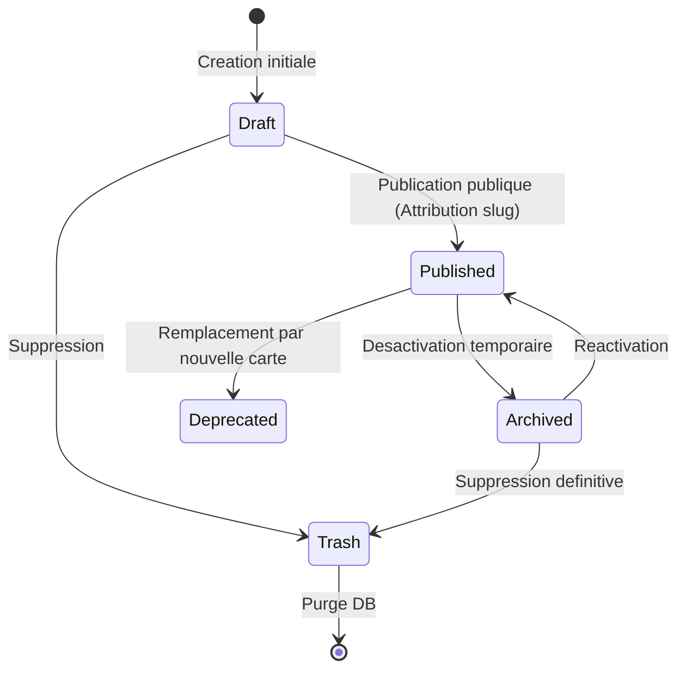

# Reference Technique : Modelisation Logicielle & Donnees

Ce document regroupe les modeles d'implementation, regles d'analyse et exemples techniques a mobiliser lors de l'application du skill `domain-and-data-modeling`.

---

## 1. Guide de normalisation relationnelle pas a pas

### 1.1 Premiere Forme Normale (1NF)
* **Regle** : Chaque colonne ne contient qu'une seule valeur scalaire atomique (pas de liste, pas de separateurs virgule/point-virgule) et la table possede une cle primaire identifiant chaque ligne.
* **Exemple de violation** :
  ```text
  INVALIDE : table 'cards' avec colonne 'phones' = "+22501020304, +22505060708"
  ```
* **Correction** :
  * Si le nombre de numeros est borne et a un sens fixe : colonnes distinctes (`phone_primary`, `phone_whatsapp`).
  * Si la cardinalite est variable N : table separee `card_phones (card_id, phone_number, phone_type)`.

### 1.2 Deuxieme Forme Normale (2NF)
* **Regle** : Être en 1NF et tout attribut non-cle doit dependre de la **totalite** de la cle primaire (concerne les cles primaires composites).
* **Exemple de violation** :
  ```text
  INVALIDE : table 'card_tags (card_id, tag_id, tag_name)'
  Ici, 'tag_name' ne depend que de 'tag_id', pas du couple (card_id, tag_id).
  ```
* **Correction** :
  * Table `tags (id, name, slug)`.
  * Table associative `card_tags (card_id, tag_id, assigned_at)`.

### 1.3 Troisieme Forme Normale (3NF)
* **Regle** : Être en 2NF et aucun attribut non-cle ne doit dependre d'un autre attribut non-cle (elimination des dependances transitives).
* **Exemple de violation** :
  ```text
  INVALIDE : table 'cards (id, first_name, last_name, company_id, company_name, company_city)'
  Ici : id -> company_id -> company_name (dependance transitive).
  ```
* **Correction** :
  * Table `companies (id, name, city)`.
  * Table `cards (id, first_name, last_name, company_id)`.

### 1.4 Forme Normale de Boyce-Codd (BCNF)
* **Regle** : Être en 3NF et pour toute dependance fonctionnelle $X \rightarrow Y$, $X$ doit être une sur-cle (ou superkey).

---

## 2. Diagrammes Mermaid standardises

### 2.1 Diagramme Entite-Relation (ERD)



### 2.2 Diagramme de machine a etats (Cycle de vie)



---

## 3. Patrons Domain-Driven Design (DDD)

### 3.1 Entite vs Value Object

| Critere | Entity | Value Object |
|---|---|---|
| **Identite** | Possede un ID unique perenne | Pas d'identite propre, defini par la valeur |
| **Mutabilite** | Son etat evolue dans le temps | Immuable (toute modification cree une nouvelle instance) |
| **Egalite** | `a.id === b.id` | Toutes les proprietes sont egales |
| **Exemples** | `Card`, `User`, `Account` | `PhoneNumber`, `EmailAddress`, `Slug`, `ThemePalette` |

### 3.2 Exemple d'implementation Value Object (JavaScript)

```javascript
class EmailAddress {
  #value;

  constructor(rawEmail) {
    const cleaned = String(rawEmail || '').trim().toLowerCase();
    if (!cleaned || !/^[^\s@]+@[^\s@]+\.[^\s@]+$/.test(cleaned)) {
      throw new Error(`Adresse email invalide : ${rawEmail}`);
    }
    this.#value = cleaned;
    Object.freeze(this);
  }

  get value() {
    return this.#value;
  }

  equals(other) {
    return other instanceof EmailAddress && other.value === this.#value;
  }
}
```

### 3.3 Aggregate Root et Invariants

Un Agregat est une frontiere de consistance transactionnelle. L'Aggregate Root est le point d'entree unique :
* Aucun code exterieur ne modifie directement une entite enfant sans passer par l'Aggregate Root.
* L'Aggregate Root verifie les regles d'invariants metier avant toute modification.
* La persistance (Repository) sauvegarde ou charge l'agregat en bloc.

---

## 4. Modeles DDL SQL types

### 4.1 Schema robuste SQLite (avec contraintes strictes)

```sql
PRAGMA foreign_keys = ON;

-- Table principale avec contraintes d'integrite fortes
CREATE TABLE IF NOT EXISTS cards (
    slug TEXT PRIMARY KEY NOT NULL CHECK (length(slug) >= 2 AND length(slug) <= 64),
    first_name TEXT NOT NULL DEFAULT '' CHECK (length(first_name) <= 100),
    last_name TEXT NOT NULL DEFAULT '' CHECK (length(last_name) <= 100),
    job_title TEXT NOT NULL DEFAULT '' CHECK (length(job_title) <= 120),
    organization TEXT NOT NULL DEFAULT '' CHECK (length(organization) <= 120),
    phone TEXT NOT NULL DEFAULT '' CHECK (length(phone) <= 30),
    whatsapp TEXT NOT NULL DEFAULT '' CHECK (length(whatsapp) <= 30),
    email TEXT NOT NULL DEFAULT '' CHECK (length(email) <= 160),
    location TEXT NOT NULL DEFAULT '' CHECK (length(location) <= 120),
    linkedin_url TEXT NOT NULL DEFAULT '' CHECK (length(linkedin_url) <= 300),
    portfolio_url TEXT NOT NULL DEFAULT '' CHECK (length(portfolio_url) <= 300),
    bio TEXT NOT NULL DEFAULT '' CHECK (length(bio) <= 300),
    photo_url TEXT NOT NULL DEFAULT '' CHECK (length(photo_url) <= 500),
    photo_base64 TEXT NOT NULL DEFAULT '',
    theme TEXT NOT NULL DEFAULT 'obsidian' CHECK (theme IN ('obsidian', 'forest', 'cobalt', 'bronze', 'bordeaux')),
    auto_download INTEGER NOT NULL DEFAULT 1 CHECK (auto_download IN (0, 1)),
    scans INTEGER NOT NULL DEFAULT 0 CHECK (scans >= 0),
    version INTEGER NOT NULL DEFAULT 1,
    created_at TEXT NOT NULL DEFAULT (strftime('%Y-%m-%dT%H:%M:%SZ', 'now')),
    updated_at TEXT NOT NULL DEFAULT (strftime('%Y-%m-%dT%H:%M:%SZ', 'now'))
);

-- Index pour requêtes par date et scans frequents
CREATE INDEX IF NOT EXISTS idx_cards_updated ON cards (updated_at DESC);
CREATE INDEX IF NOT EXISTS idx_cards_theme ON cards (theme);

-- Table des evenements de scan (Append-Only pour audit et statistiques)
CREATE TABLE IF NOT EXISTS card_scans (
    id INTEGER PRIMARY KEY AUTOINCREMENT,
    card_slug TEXT NOT NULL,
    ip_anonymized TEXT NOT NULL DEFAULT '',
    user_agent TEXT NOT NULL DEFAULT '',
    scanned_at TEXT NOT NULL DEFAULT (strftime('%Y-%m-%dT%H:%M:%SZ', 'now')),
    FOREIGN KEY (card_slug) REFERENCES cards(slug) ON DELETE CASCADE
);

CREATE INDEX IF NOT EXISTS idx_card_scans_slug_date ON card_scans (card_slug, scanned_at DESC);
```

---

## 5. Strategie d'evolution de schema sans coupure (Expand / Contract)

Lorsqu'une evolution de modele est requise sur un systeme en production :

1. **Phase 1 (Expand)** : Ajouter la nouvelle colonne ou table sans contrainte bloquante (`NULL` autorise ou valeur par defaut sans supprimer l'ancienne colonne).
2. **Phase 2 (Dual-Write)** : Mettre a jour le code applicatif pour ecrire a la fois dans l'ancienne et la nouvelle structure.
3. **Phase 3 (Backfill)** : Executer un script de migration en tâche de fond pour synchroniser l'historique ancien vers les nouvelles colonnes.
4. **Phase 4 (Read Switch)** : Basculer les lectures sur la nouvelle structure uniquement.
5. **Phase 5 (Contract)** : Retirer les ecritures sur l'ancienne colonne, ajouter les contraintes finales (`NOT NULL`) et supprimer l'ancienne colonne.

